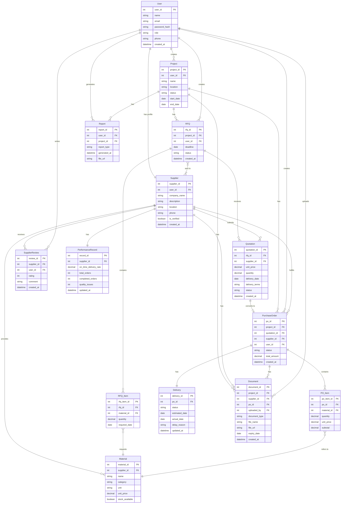
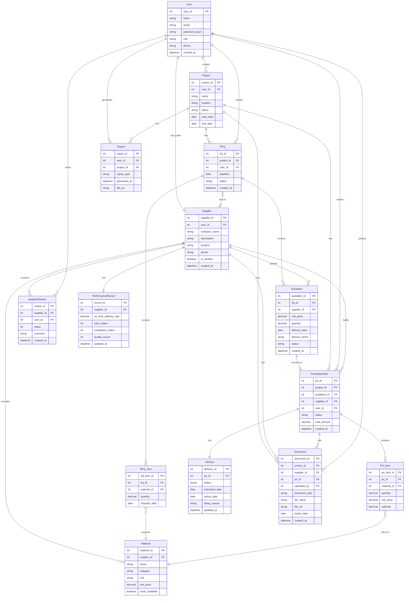

# SUPPLIX - Normalized ER Diagram (3NF)

## Overview

This document presents the normalized Entity-Relationship (ER) diagram for the SUPPLIX construction material supplier management platform. The data model is normalized to Third Normal Form (3NF) to eliminate data redundancy and ensure data integrity.

## Scope Legend

- 🟢 `[MVP]` — Entity is required for the initial MVP launch
- 🔵 `[FUTURE]` — Entity is planned for future development

## Normalization Notes

The data model follows the three normalization rules:

- **1NF:** Every attribute contains a single value. Multi-valued attributes are separated into their own tables (e.g. `RFQ_Item`, `PO_Item`).
- **2NF:** Every non-key attribute is fully dependent on the primary key. Supplier details are stored in the `Supplier` table, not repeated in `Quotation` or `PurchaseOrder`.
- **3NF:** Every attribute depends directly on the primary key, not through another attribute. For example, `company_name` and `location` are stored in `Supplier`, not in `Material` or `Quotation`.

## Many-to-Many Relationships

The following M:M relationship requires a junction table in physical implementation:

| Relationship | Junction Table | Attributes |
|---|---|---|
| `RFQ` ↔ `Supplier` | `RFQ_Supplier` | `rfq_id`, `supplier_id`, `status`, `invited_at` |

---

## Entity Definitions

### 🟢 MVP Entities

#### User
| Attribute | Type | Constraint | Description |
|---|---|---|---|
| `user_id` | INT | PK | Unique user identifier |
| `name` | VARCHAR | NOT NULL | Full name |
| `email` | VARCHAR | NOT NULL, UNIQUE | Login email |
| `password_hash` | VARCHAR | NOT NULL | Encrypted password |
| `role` | ENUM | NOT NULL | GC / Supplier / PM |
| `phone` | VARCHAR | | Contact number |
| `created_at` | DATETIME | NOT NULL | Registration time |

#### Project
| Attribute | Type | Constraint | Description |
|---|---|---|---|
| `project_id` | INT | PK | Unique project identifier |
| `user_id` | INT | FK → User | GC who owns the project |
| `name` | VARCHAR | NOT NULL | Project name |
| `location` | VARCHAR | | Project site location |
| `status` | ENUM | NOT NULL | active / completed |
| `start_date` | DATE | | Project start date |
| `end_date` | DATE | | Project end date |

#### Supplier
| Attribute | Type | Constraint | Description |
|---|---|---|---|
| `supplier_id` | INT | PK | Unique supplier identifier |
| `user_id` | INT | FK → User | Linked user account |
| `company_name` | VARCHAR | NOT NULL | Company name |
| `description` | TEXT | | Company description |
| `location` | VARCHAR | | Service area |
| `phone` | VARCHAR | | Company phone |
| `is_verified` | BOOLEAN | NOT NULL | Verified badge status |
| `created_at` | DATETIME | NOT NULL | Profile creation time |

#### Material
| Attribute | Type | Constraint | Description |
|---|---|---|---|
| `material_id` | INT | PK | Unique material identifier |
| `supplier_id` | INT | FK → Supplier | Supplier who provides this material |
| `name` | VARCHAR | NOT NULL | Material name |
| `category` | VARCHAR | NOT NULL | Material category |
| `unit` | VARCHAR | NOT NULL | Unit of measurement |
| `unit_price` | DECIMAL | NOT NULL | Price per unit |
| `stock_available` | BOOLEAN | NOT NULL | Availability status |

#### RFQ
| Attribute | Type | Constraint | Description |
|---|---|---|---|
| `rfq_id` | INT | PK | Unique RFQ identifier |
| `project_id` | INT | FK → Project | Related project |
| `user_id` | INT | FK → User | GC who created the RFQ |
| `deadline` | DATE | NOT NULL | Quote submission deadline |
| `status` | ENUM | NOT NULL | open / closed |
| `created_at` | DATETIME | NOT NULL | Creation time |

#### RFQ_Item
| Attribute | Type | Constraint | Description |
|---|---|---|---|
| `rfq_item_id` | INT | PK | Unique item identifier |
| `rfq_id` | INT | FK → RFQ | Related RFQ |
| `material_id` | INT | FK → Material | Required material |
| `quantity` | DECIMAL | NOT NULL | Required quantity |
| `required_date` | DATE | | Required delivery date |

#### Quotation
| Attribute | Type | Constraint | Description |
|---|---|---|---|
| `quotation_id` | INT | PK | Unique quotation identifier |
| `rfq_id` | INT | FK → RFQ | Related RFQ |
| `supplier_id` | INT | FK → Supplier | Supplier who submitted the quote |
| `unit_price` | DECIMAL | NOT NULL | Quoted unit price |
| `quantity` | DECIMAL | NOT NULL | Available quantity |
| `delivery_date` | DATE | NOT NULL | Estimated delivery date |
| `delivery_terms` | TEXT | | Delivery conditions |
| `status` | ENUM | NOT NULL | pending / accepted / rejected |
| `created_at` | DATETIME | NOT NULL | Submission time |

#### PurchaseOrder
| Attribute | Type | Constraint | Description |
|---|---|---|---|
| `po_id` | INT | PK | Unique PO identifier |
| `project_id` | INT | FK → Project | Related project |
| `quotation_id` | INT | FK → Quotation | Quotation this PO is based on |
| `supplier_id` | INT | FK → Supplier | Supplier fulfilling the order |
| `user_id` | INT | FK → User | GC who created the PO |
| `status` | ENUM | NOT NULL | pending / accepted / in_progress / fulfilled |
| `total_amount` | DECIMAL | NOT NULL | Total order amount |
| `created_at` | DATETIME | NOT NULL | Creation time |

#### PO_Item
| Attribute | Type | Constraint | Description |
|---|---|---|---|
| `po_item_id` | INT | PK | Unique item identifier |
| `po_id` | INT | FK → PurchaseOrder | Related PO |
| `material_id` | INT | FK → Material | Material ordered |
| `quantity` | DECIMAL | NOT NULL | Ordered quantity |
| `unit_price` | DECIMAL | NOT NULL | Unit price at time of order |
| `subtotal` | DECIMAL | NOT NULL | Line item total |

#### Delivery
| Attribute | Type | Constraint | Description |
|---|---|---|---|
| `delivery_id` | INT | PK | Unique delivery identifier |
| `po_id` | INT | FK → PurchaseOrder | Related PO |
| `status` | ENUM | NOT NULL | dispatched / out_for_delivery / delivered / delayed |
| `estimated_date` | DATE | NOT NULL | Expected delivery date |
| `actual_date` | DATE | | Actual delivery date |
| `delay_reason` | TEXT | | Reason for delay if applicable |
| `updated_at` | DATETIME | NOT NULL | Last update time |

#### Document
| Attribute | Type | Constraint | Description |
|---|---|---|---|
| `document_id` | INT | PK | Unique document identifier |
| `project_id` | INT | FK → Project | Related project |
| `supplier_id` | INT | FK → Supplier | Related supplier |
| `po_id` | INT | FK → PurchaseOrder | Related PO (optional) |
| `uploaded_by` | INT | FK → User | User who uploaded the document |
| `document_type` | ENUM | NOT NULL | certificate / invoice / safety_sheet / contract |
| `file_name` | VARCHAR | NOT NULL | File name |
| `file_url` | VARCHAR | NOT NULL | File storage path |
| `expiry_date` | DATE | | Document expiry date |
| `created_at` | DATETIME | NOT NULL | Upload time |

---

### 🔵 Future Entities

#### SupplierReview
| Attribute | Type | Constraint | Description |
|---|---|---|---|
| `review_id` | INT | PK | Unique review identifier |
| `supplier_id` | INT | FK → Supplier | Reviewed supplier |
| `user_id` | INT | FK → User | GC who wrote the review |
| `rating` | INT | NOT NULL | Rating score (1-5) |
| `comment` | TEXT | | Review comment |
| `created_at` | DATETIME | NOT NULL | Review time |

#### PerformanceRecord
| Attribute | Type | Constraint | Description |
|---|---|---|---|
| `record_id` | INT | PK | Unique record identifier |
| `supplier_id` | INT | FK → Supplier | Related supplier |
| `on_time_delivery_rate` | DECIMAL | NOT NULL | On-time delivery percentage |
| `total_orders` | INT | NOT NULL | Total number of orders |
| `completed_orders` | INT | NOT NULL | Number of completed orders |
| `quality_issues` | INT | NOT NULL | Number of recorded quality issues |
| `updated_at` | DATETIME | NOT NULL | Last update time |

#### Report
| Attribute | Type | Constraint | Description |
|---|---|---|---|
| `report_id` | INT | PK | Unique report identifier |
| `user_id` | INT | FK → User | User who generated the report |
| `project_id` | INT | FK → Project | Related project |
| `report_type` | ENUM | NOT NULL | procurement / performance |
| `generated_at` | DATETIME | NOT NULL | Generation time |
| `file_url` | VARCHAR | NOT NULL | Report file path |

---## Entity Definitions

### 🟢 MVP Entities

#### User
| Attribute | Type | Constraint | Description |
|---|---|---|---|
| `user_id` | INT | PK | Unique user identifier |
| `name` | VARCHAR | NOT NULL | Full name |
| `email` | VARCHAR | NOT NULL, UNIQUE | Login email |
| `password_hash` | VARCHAR | NOT NULL | Encrypted password |
| `role` | ENUM | NOT NULL | GC / Supplier / PM |
| `phone` | VARCHAR | | Contact number |
| `created_at` | DATETIME | NOT NULL | Registration time |

#### Project
| Attribute | Type | Constraint | Description |
|---|---|---|---|
| `project_id` | INT | PK | Unique project identifier |
| `user_id` | INT | FK → User | GC who owns the project |
| `name` | VARCHAR | NOT NULL | Project name |
| `location` | VARCHAR | | Project site location |
| `status` | ENUM | NOT NULL | active / completed |
| `start_date` | DATE | | Project start date |
| `end_date` | DATE | | Project end date |

#### Supplier
| Attribute | Type | Constraint | Description |
|---|---|---|---|
| `supplier_id` | INT | PK | Unique supplier identifier |
| `user_id` | INT | FK → User | Linked user account |
| `company_name` | VARCHAR | NOT NULL | Company name |
| `description` | TEXT | | Company description |
| `location` | VARCHAR | | Service area |
| `phone` | VARCHAR | | Company phone |
| `is_verified` | BOOLEAN | NOT NULL | Verified badge status |
| `created_at` | DATETIME | NOT NULL | Profile creation time |

#### Material
| Attribute | Type | Constraint | Description |
|---|---|---|---|
| `material_id` | INT | PK | Unique material identifier |
| `supplier_id` | INT | FK → Supplier | Supplier who provides this material |
| `name` | VARCHAR | NOT NULL | Material name |
| `category` | VARCHAR | NOT NULL | Material category |
| `unit` | VARCHAR | NOT NULL | Unit of measurement |
| `unit_price` | DECIMAL | NOT NULL | Price per unit |
| `stock_available` | BOOLEAN | NOT NULL | Availability status |

#### RFQ
| Attribute | Type | Constraint | Description |
|---|---|---|---|
| `rfq_id` | INT | PK | Unique RFQ identifier |
| `project_id` | INT | FK → Project | Related project |
| `user_id` | INT | FK → User | GC who created the RFQ |
| `deadline` | DATE | NOT NULL | Quote submission deadline |
| `status` | ENUM | NOT NULL | open / closed |
| `created_at` | DATETIME | NOT NULL | Creation time |

#### RFQ_Item
| Attribute | Type | Constraint | Description |
|---|---|---|---|
| `rfq_item_id` | INT | PK | Unique item identifier |
| `rfq_id` | INT | FK → RFQ | Related RFQ |
| `material_id` | INT | FK → Material | Required material |
| `quantity` | DECIMAL | NOT NULL | Required quantity |
| `required_date` | DATE | | Required delivery date |

#### Quotation
| Attribute | Type | Constraint | Description |
|---|---|---|---|
| `quotation_id` | INT | PK | Unique quotation identifier |
| `rfq_id` | INT | FK → RFQ | Related RFQ |
| `supplier_id` | INT | FK → Supplier | Supplier who submitted the quote |
| `unit_price` | DECIMAL | NOT NULL | Quoted unit price |
| `quantity` | DECIMAL | NOT NULL | Available quantity |
| `delivery_date` | DATE | NOT NULL | Estimated delivery date |
| `delivery_terms` | TEXT | | Delivery conditions |
| `status` | ENUM | NOT NULL | pending / accepted / rejected |
| `created_at` | DATETIME | NOT NULL | Submission time |

#### PurchaseOrder
| Attribute | Type | Constraint | Description |
|---|---|---|---|
| `po_id` | INT | PK | Unique PO identifier |
| `project_id` | INT | FK → Project | Related project |
| `quotation_id` | INT | FK → Quotation | Quotation this PO is based on |
| `supplier_id` | INT | FK → Supplier | Supplier fulfilling the order |
| `user_id` | INT | FK → User | GC who created the PO |
| `status` | ENUM | NOT NULL | pending / accepted / in_progress / fulfilled |
| `total_amount` | DECIMAL | NOT NULL | Total order amount |
| `created_at` | DATETIME | NOT NULL | Creation time |

#### PO_Item
| Attribute | Type | Constraint | Description |
|---|---|---|---|
| `po_item_id` | INT | PK | Unique item identifier |
| `po_id` | INT | FK → PurchaseOrder | Related PO |
| `material_id` | INT | FK → Material | Material ordered |
| `quantity` | DECIMAL | NOT NULL | Ordered quantity |
| `unit_price` | DECIMAL | NOT NULL | Unit price at time of order |
| `subtotal` | DECIMAL | NOT NULL | Line item total |

#### Delivery
| Attribute | Type | Constraint | Description |
|---|---|---|---|
| `delivery_id` | INT | PK | Unique delivery identifier |
| `po_id` | INT | FK → PurchaseOrder | Related PO |
| `status` | ENUM | NOT NULL | dispatched / out_for_delivery / delivered / delayed |
| `estimated_date` | DATE | NOT NULL | Expected delivery date |
| `actual_date` | DATE | | Actual delivery date |
| `delay_reason` | TEXT | | Reason for delay if applicable |
| `updated_at` | DATETIME | NOT NULL | Last update time |

#### Document
| Attribute | Type | Constraint | Description |
|---|---|---|---|
| `document_id` | INT | PK | Unique document identifier |
| `project_id` | INT | FK → Project | Related project |
| `supplier_id` | INT | FK → Supplier | Related supplier |
| `po_id` | INT | FK → PurchaseOrder | Related PO (optional) |
| `uploaded_by` | INT | FK → User | User who uploaded the document |
| `document_type` | ENUM | NOT NULL | certificate / invoice / safety_sheet / contract |
| `file_name` | VARCHAR | NOT NULL | File name |
| `file_url` | VARCHAR | NOT NULL | File storage path |
| `expiry_date` | DATE | | Document expiry date |
| `created_at` | DATETIME | NOT NULL | Upload time |

---

### 🔵 Future Entities

#### SupplierReview
| Attribute | Type | Constraint | Description |
|---|---|---|---|
| `review_id` | INT | PK | Unique review identifier |
| `supplier_id` | INT | FK → Supplier | Reviewed supplier |
| `user_id` | INT | FK → User | GC who wrote the review |
| `rating` | INT | NOT NULL | Rating score (1-5) |
| `comment` | TEXT | | Review comment |
| `created_at` | DATETIME | NOT NULL | Review time |

#### PerformanceRecord
| Attribute | Type | Constraint | Description |
|---|---|---|---|
| `record_id` | INT | PK | Unique record identifier |
| `supplier_id` | INT | FK → Supplier | Related supplier |
| `on_time_delivery_rate` | DECIMAL | NOT NULL | On-time delivery percentage |
| `total_orders` | INT | NOT NULL | Total number of orders |
| `completed_orders` | INT | NOT NULL | Number of completed orders |
| `quality_issues` | INT | NOT NULL | Number of recorded quality issues |
| `updated_at` | DATETIME | NOT NULL | Last update time |

#### Report
| Attribute | Type | Constraint | Description |
|---|---|---|---|
| `report_id` | INT | PK | Unique report identifier |
| `user_id` | INT | FK → User | User who generated the report |
| `project_id` | INT | FK → Project | Related project |
| `report_type` | ENUM | NOT NULL | procurement / performance |
| `generated_at` | DATETIME | NOT NULL | Generation time |
| `file_url` | VARCHAR | NOT NULL | Report file path |

---

## Business Rules

The following business rules define the constraints and logic governing entity relationships.

### User & Access
- A User must have exactly one role: GC, Supplier, or PM.
- A Supplier user must have exactly one Supplier profile.
- A PM acts on behalf of a GC and can access the same projects.

### Project
- A Project must be owned by exactly one GC (User with role = GC).
- A GC can own multiple Projects.
- A Project must exist before an RFQ can be created.

### Supplier & Material
- A Supplier must be linked to exactly one User account.
- A Supplier can list multiple Materials.
- A Material belongs to exactly one Supplier.
- A Supplier can receive a verified badge only after submitting credentials.

### RFQ & Quotation
- An RFQ must belong to exactly one Project.
- An RFQ can be sent to one or more Suppliers.
- A Supplier can receive multiple RFQs.
- An RFQ can have one or more RFQ_Items.
- Each RFQ_Item refers to exactly one Material.
- A Supplier can submit at most one Quotation per RFQ.
- A Quotation must reference exactly one RFQ and one Supplier.

### Purchase Order
- A PurchaseOrder must be created from exactly one accepted Quotation.
- A PurchaseOrder belongs to exactly one Project.
- A PurchaseOrder is fulfilled by exactly one Supplier.
- A PurchaseOrder can have one or more PO_Items.
- Each PO_Item refers to exactly one Material.

### Delivery
- Each PurchaseOrder has exactly one Delivery record.
- A Delivery status must be updated by the Supplier.
- A Delivery can be marked as delayed with a reason provided.

### Document
- A Document must be associated with at least one Supplier or Project.
- A Document can optionally be linked to a PurchaseOrder.
- Documents with an expiry date will trigger alerts before expiration.

### Future Rules
- A SupplierReview can only be written by a GC who has completed at least one order with that Supplier.
- A PerformanceRecord is automatically updated after each completed order.
- A Report can only be generated by a GC or PM.

---## Business Rules

The following business rules define the constraints and logic governing entity relationships.

### User & Access
- A User must have exactly one role: GC, Supplier, or PM.
- A Supplier user must have exactly one Supplier profile.
- A PM acts on behalf of a GC and can access the same projects.

### Project
- A Project must be owned by exactly one GC (User with role = GC).
- A GC can own multiple Projects.
- A Project must exist before an RFQ can be created.

### Supplier & Material
- A Supplier must be linked to exactly one User account.
- A Supplier can list multiple Materials.
- A Material belongs to exactly one Supplier.
- A Supplier can receive a verified badge only after submitting credentials.

### RFQ & Quotation
- An RFQ must belong to exactly one Project.
- An RFQ can be sent to one or more Suppliers.
- A Supplier can receive multiple RFQs.
- An RFQ can have one or more RFQ_Items.
- Each RFQ_Item refers to exactly one Material.
- A Supplier can submit at most one Quotation per RFQ.
- A Quotation must reference exactly one RFQ and one Supplier.

### Purchase Order
- A PurchaseOrder must be created from exactly one accepted Quotation.
- A PurchaseOrder belongs to exactly one Project.
- A PurchaseOrder is fulfilled by exactly one Supplier.
- A PurchaseOrder can have one or more PO_Items.
- Each PO_Item refers to exactly one Material.

### Delivery
- Each PurchaseOrder has exactly one Delivery record.
- A Delivery status must be updated by the Supplier.
- A Delivery can be marked as delayed with a reason provided.

### Document
- A Document must be associated with at least one Supplier or Project.
- A Document can optionally be linked to a PurchaseOrder.
- Documents with an expiry date will trigger alerts before expiration.

### Future Rules
- A SupplierReview can only be written by a GC who has completed at least one order with that Supplier.
- A PerformanceRecord is automatically updated after each completed order.
- A Report can only be generated by a GC or PM.

---

## ER Diagram

> 🟢 Green entities are part of the MVP scope.
> 🔵 Blue entities are planned for future development.

## ER Diagram

> 🟢 Green entities are part of the MVP scope.
> 🔵 Blue entities are planned for future development.

