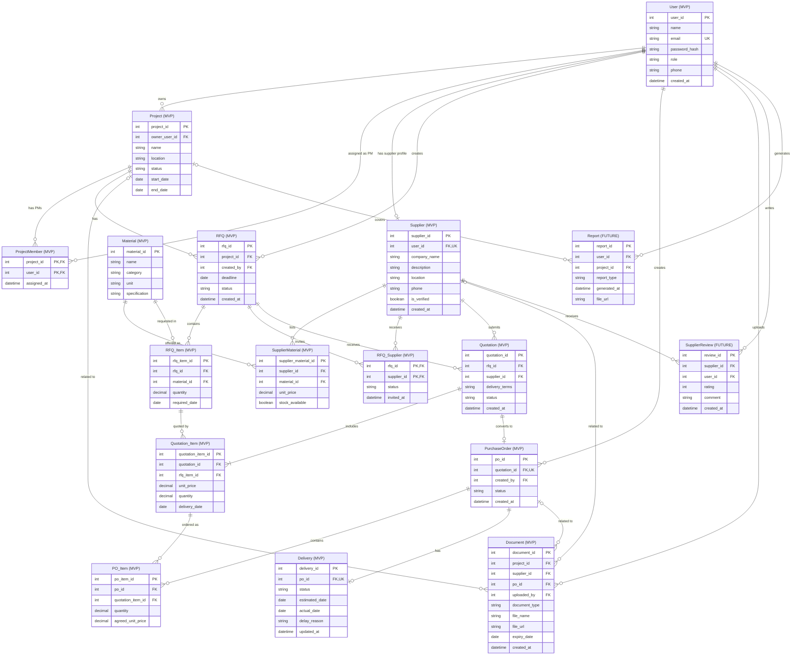

# SUPPLIX - Normalized ER Diagram (3NF)

## Overview

This document defines the proposed relational data model, designed following Third Normal Form (3NF) principles, for SUPPLIX, a construction material supplier management web application. It supports the five MVP features: Supplier Directory, Quote Request & Comparison, Order Management, Delivery Tracking, and Document Vault.

The model separates shared material specifications from supplier-specific listings, supports multi-item quotation requests and quotations, and avoids storing project and supplier information redundantly in purchase orders.

## Scope Legend

- 🟢 **MVP** — Required for the initial MVP release.
- 🔵 **FUTURE** — Planned for later development.
- **PK** — Primary key.
- **FK** — Foreign key.
- **UNIQUE** — Unique constraint.
- Cardinalities describe allowable stored records. Requirements that depend on workflow state, such as an issued purchase order having at least one item, are specified separately as business rules.

## Normalization Notes (3NF)

The proposed relational tables follow Third Normal Form (3NF) design principles: each field holds an atomic value; non-key attributes depend on candidate keys without partial or transitive dependencies. Full 3NF verification requires validating functional dependencies and candidate keys against the final business requirements.

- Supplier company details are stored in `Supplier`, not repeated in `SupplierMaterial`, `Quotation`, or `PurchaseOrder`.
- Shared material descriptions are stored in `Material`. Supplier-specific catalog prices and availability are stored in `SupplierMaterial`.
- RFQ recipients are represented by `RFQ_Supplier` instead of a direct many-to-many relationship.
- Quotation header data is stored in `Quotation`, while per-material quantities, prices, and proposed delivery dates are stored in `Quotation_Item`.
- `PurchaseOrder` references an accepted quotation. Its project and supplier are determined through `Quotation` and `RFQ`, rather than duplicated in `PurchaseOrder`.
- `PO_Item.agreed_unit_price` represents the agreed contractual price for that order line, which may be retained as a historical transaction value. Calculated subtotals and order totals are not stored as independent base-table attributes.
- Supplier performance statistics are computed from transaction records for reporting rather than duplicated in an editable base table.

These are design-level normalization decisions. Database implementation must additionally enforce the constraints and cross-table consistency rules described below.

## Many-to-Many Relationships

| Relationship | Junction Table | Purpose |
|---|---|---|
| `RFQ` ↔ `Supplier` | `RFQ_Supplier` | Track suppliers invited to each RFQ |
| `Supplier` ↔ `Material` | `SupplierMaterial` | Track supplier-specific listings, prices, and stock availability |
| `Project` ↔ `User` (PM access) | `ProjectMember` | Assign project managers to projects |

---

## Entity Definitions

### 🟢 MVP Entities

#### User

| Attribute | Type | Constraint | Description |
|---|---|---|---|
| `user_id` | INT | PK | Unique user identifier |
| `name` | VARCHAR | NOT NULL | Full name |
| `email` | VARCHAR | NOT NULL, UNIQUE | Login email |
| `password_hash` | VARCHAR | NOT NULL | Secure password hash |
| `role` | ENUM | NOT NULL | GC / Supplier / PM |
| `phone` | VARCHAR | | Contact number |
| `created_at` | DATETIME | NOT NULL | Registration timestamp |

#### Project

| Attribute | Type | Constraint | Description |
|---|---|---|---|
| `project_id` | INT | PK | Unique project identifier |
| `owner_user_id` | INT | NOT NULL, FK → User | GC who owns the project |
| `name` | VARCHAR | NOT NULL | Project name |
| `location` | VARCHAR | | Project site location |
| `status` | ENUM | NOT NULL | active / completed |
| `start_date` | DATE | | Project start date |
| `end_date` | DATE | | Project end date |

#### ProjectMember

| Attribute | Type | Constraint | Description |
|---|---|---|---|
| `project_id` | INT | PK, FK → Project | Assigned project |
| `user_id` | INT | PK, FK → User | Assigned PM |
| `assigned_at` | DATETIME | NOT NULL | Assignment timestamp |

**Primary Key:** (`project_id`, `user_id`)

#### Supplier

| Attribute | Type | Constraint | Description |
|---|---|---|---|
| `supplier_id` | INT | PK | Unique supplier identifier |
| `user_id` | INT | NOT NULL, UNIQUE, FK → User | Linked supplier account |
| `company_name` | VARCHAR | NOT NULL | Company name |
| `description` | TEXT | | Company description |
| `location` | VARCHAR | | Service area |
| `phone` | VARCHAR | | Company phone |
| `is_verified` | BOOLEAN | NOT NULL, DEFAULT FALSE | Verified badge is shown only after an authorized credential review |
| `created_at` | DATETIME | NOT NULL | Profile creation timestamp |

#### Material

| Attribute | Type | Constraint | Description |
|---|---|---|---|
| `material_id` | INT | PK | Unique material specification identifier |
| `name` | VARCHAR | NOT NULL | Material name |
| `category` | VARCHAR | NOT NULL | Material category |
| `unit` | VARCHAR | NOT NULL | Unit of measurement |
| `specification` | TEXT | | Common material specification |

#### SupplierMaterial

| Attribute | Type | Constraint | Description |
|---|---|---|---|
| `supplier_material_id` | INT | PK | Unique supplier listing identifier |
| `supplier_id` | INT | NOT NULL, FK → Supplier | Listing supplier |
| `material_id` | INT | NOT NULL, FK → Material | Listed material specification |
| `unit_price` | DECIMAL | NOT NULL | Current catalog unit price |
| `stock_available` | BOOLEAN | NOT NULL | Current availability |

**Constraint:** `UNIQUE(supplier_id, material_id)` for one current listing per supplier and material specification.

#### RFQ

| Attribute | Type | Constraint | Description |
|---|---|---|---|
| `rfq_id` | INT | PK | Unique RFQ identifier |
| `project_id` | INT | NOT NULL, FK → Project | Related project |
| `created_by` | INT | NOT NULL, FK → User | Project-owning GC in MVP; authorized PM creation is FUTURE |
| `deadline` | DATE | NOT NULL | Quote submission deadline |
| `status` | ENUM | NOT NULL | draft / open / closed |
| `created_at` | DATETIME | NOT NULL | Creation timestamp |

#### RFQ_Supplier

| Attribute | Type | Constraint | Description |
|---|---|---|---|
| `rfq_id` | INT | PK, FK → RFQ | Related RFQ |
| `supplier_id` | INT | PK, FK → Supplier | Invited supplier |
| `status` | ENUM | NOT NULL | invited / responded / declined |
| `invited_at` | DATETIME | NOT NULL | Invitation timestamp |

**Primary Key:** (`rfq_id`, `supplier_id`)

#### RFQ_Item

| Attribute | Type | Constraint | Description |
|---|---|---|---|
| `rfq_item_id` | INT | PK | Unique requested line identifier |
| `rfq_id` | INT | NOT NULL, FK → RFQ | Related RFQ |
| `material_id` | INT | NOT NULL, FK → Material | Requested material specification |
| `quantity` | DECIMAL | NOT NULL | Requested quantity |
| `required_date` | DATE | | Required delivery date |

#### Quotation

| Attribute | Type | Constraint | Description |
|---|---|---|---|
| `quotation_id` | INT | PK | Unique quotation identifier |
| `rfq_id` | INT | NOT NULL, FK → RFQ | Related RFQ |
| `supplier_id` | INT | NOT NULL, FK → Supplier | Quoting supplier |
| `delivery_terms` | TEXT | | General delivery conditions |
| `status` | ENUM | NOT NULL | pending / accepted / rejected |
| `created_at` | DATETIME | NOT NULL | Submission timestamp |

**Constraints:**

- `UNIQUE(rfq_id, supplier_id)` ensures that each supplier submits at most one quotation per RFQ.
- `(rfq_id, supplier_id)` must reference an existing `RFQ_Supplier` invitation.
- At most one quotation per RFQ may have `status = accepted` in the MVP.
- Conditional uniqueness must be enforced using an appropriate database index, trigger, or transactional validation.

#### Quotation_Item

| Attribute | Type | Constraint | Description |
|---|---|---|---|
| `quotation_item_id` | INT | PK | Unique quoted line identifier |
| `quotation_id` | INT | NOT NULL, FK → Quotation | Related quotation |
| `rfq_item_id` | INT | NOT NULL, FK → RFQ_Item | Requested line being quoted |
| `unit_price` | DECIMAL | NOT NULL | Quoted unit price |
| `quantity` | DECIMAL | NOT NULL | Offered quantity |
| `delivery_date` | DATE | NOT NULL | Proposed delivery date for this line |

**Constraint:** `UNIQUE(quotation_id, rfq_item_id)`; the referenced RFQ item must belong to the quotation's RFQ.

#### PurchaseOrder

| Attribute | Type | Constraint | Description |
|---|---|---|---|
| `po_id` | INT | PK | Unique purchase order identifier |
| `quotation_id` | INT | NOT NULL, UNIQUE, FK → Quotation | Accepted quotation used for this PO |
| `created_by` | INT | NOT NULL, FK → User | Project-owning GC in MVP; additional authorized roles are FUTURE |
| `status` | ENUM | NOT NULL | draft / pending / accepted / rejected / in_progress / fulfilled |
| `created_at` | DATETIME | NOT NULL | Creation timestamp |

**Note:** The PO's project is obtained through `Quotation → RFQ → Project`; its supplier is obtained through `Quotation → Supplier`. `draft` represents an order being prepared, while `pending` represents an issued order awaiting supplier confirmation. A rejected order cannot proceed to fulfillment without a new valid approval process.

#### PO_Item

| Attribute | Type | Constraint | Description |
|---|---|---|---|
| `po_item_id` | INT | PK | Unique purchase order line identifier |
| `po_id` | INT | NOT NULL, FK → PurchaseOrder | Related PO |
| `quotation_item_id` | INT | NOT NULL, FK → Quotation_Item | Accepted quoted line |
| `quantity` | DECIMAL | NOT NULL | Ordered quantity |
| `agreed_unit_price` | DECIMAL | NOT NULL | Contractually agreed unit price |

**Constraint:** `UNIQUE(po_id, quotation_item_id)`; the quotation item must belong to the PO's accepted quotation. `subtotal = quantity × agreed_unit_price` is calculated when needed.

#### Delivery

| Attribute | Type | Constraint | Description |
|---|---|---|---|
| `delivery_id` | INT | PK | Unique delivery identifier |
| `po_id` | INT | NOT NULL, UNIQUE, FK → PurchaseOrder | Related PO |
| `status` | ENUM | NOT NULL | dispatched / out_for_delivery / delivered / delayed |
| `estimated_date` | DATE | NOT NULL | Expected delivery date |
| `actual_date` | DATE | | Actual delivery date |
| `delay_reason` | TEXT | | Reason for delay if applicable |
| `updated_at` | DATETIME | NOT NULL | Last update timestamp |

#### Document

| Attribute | Type | Constraint | Description |
|---|---|---|---|
| `document_id` | INT | PK | Unique document identifier |
| `project_id` | INT | NULL, FK → Project | Related project, if applicable |
| `supplier_id` | INT | NULL, FK → Supplier | Related supplier, if applicable |
| `po_id` | INT | NULL, FK → PurchaseOrder | Related PO, if applicable |
| `uploaded_by` | INT | NOT NULL, FK → User | User who uploaded the document |
| `document_type` | ENUM | NOT NULL | certificate / invoice / safety_sheet / contract |
| `file_name` | VARCHAR | NOT NULL | File name |
| `file_url` | VARCHAR | NOT NULL | File storage path |
| `expiry_date` | DATE | | Document expiry date |
| `created_at` | DATETIME | NOT NULL | Upload timestamp |

**Constraint:** At least one of `project_id`, `supplier_id`, or `po_id` must be non-NULL. When multiple references are provided, they must be consistent with the linked procurement records.

### 🔵 Future Entities

#### SupplierReview

| Attribute | Type | Constraint | Description |
|---|---|---|---|
| `review_id` | INT | PK | Unique review identifier |
| `supplier_id` | INT | NOT NULL, FK → Supplier | Reviewed supplier |
| `user_id` | INT | NOT NULL, FK → User | GC who wrote the review |
| `rating` | INT | NOT NULL, CHECK 1–5 | Rating score |
| `comment` | TEXT | | Review comment |
| `created_at` | DATETIME | NOT NULL | Review timestamp |

#### Report

| Attribute | Type | Constraint | Description |
|---|---|---|---|
| `report_id` | INT | PK | Unique report identifier |
| `user_id` | INT | NOT NULL, FK → User | GC or PM who generated the report |
| `project_id` | INT | NULL, FK → Project | Related project, if applicable |
| `report_type` | ENUM | NOT NULL | procurement / performance |
| `generated_at` | DATETIME | NOT NULL | Generation timestamp |
| `file_url` | VARCHAR | NOT NULL | Generated report location |

#### SupplierPerformance (Future Reporting View)

`SupplierPerformance` is a **derived reporting view**, not a base table. It may expose `supplier_id`, `total_orders`, `completed_orders`, `on_time_delivery_rate`, and other metrics calculated from `PurchaseOrder` and `Delivery`.

A quality-issue metric requires an additional, explicitly defined quality-issue data source in a future release; it cannot be reliably calculated from the current MVP schema.

---

## Business Rules

### User & Access

- Each User has exactly one role: GC, Supplier, or PM.
- A Supplier-role User must have exactly one Supplier profile once registration is complete; GC and PM users must not have Supplier profiles. Registration must create the linked records atomically or prevent incomplete accounts from becoming active.
- Each Supplier profile belongs to exactly one User account.
- In the MVP, a PM can read procurement records only for Projects assigned through `ProjectMember`; PMs cannot create RFQs, create or approve POs, or confirm deliveries. Any broader PM permissions are FUTURE.
- `ProjectMember.user_id` must reference a User with the PM role.

### Project

- Each Project is owned by exactly one GC.
- A GC can own multiple Projects.
- Project start and end dates must be chronologically consistent when both are supplied.

### Supplier & Material

- A Supplier may list multiple Materials through `SupplierMaterial`.
- A Material specification may be offered by multiple Suppliers.
- Each SupplierMaterial listing belongs to exactly one Supplier and one Material.
- Supplier verification requires supporting credentials and an authorized review decision; uploading credentials alone never grants a verified badge.
- In the MVP, credential documents can be stored in `Document`, and `Supplier.is_verified` is updated by an authorized administrative/back-office process; no separate admin user role or verification-history table is modeled.

### RFQ & Quotation

- Each RFQ belongs to one Project. In the MVP, only the GC who owns that Project may create or send its RFQs; PM-initiated RFQs are FUTURE.
- A draft RFQ may have no items or invited suppliers; before it is opened or sent, it must have at least one `RFQ_Item` and at least one invited supplier.
- An RFQ may be sent to multiple Suppliers; invitations are unique per `(rfq_id, supplier_id)`.
- Each RFQ_Item references a shared Material specification rather than a specific supplier listing.
- Only Suppliers with a matching `RFQ_Supplier` invitation may submit quotations for an open RFQ before its deadline. A quotation must contain items from that same RFQ.
- A Supplier may submit at most one Quotation per RFQ.
- A submitted Quotation must have at least one Quotation_Item; each quoted item must belong to the same RFQ as the quotation.
- A Quotation_Item specifies the offered quantity, unit price, and proposed delivery date for a requested line.
- In this MVP workflow, at most one Quotation can be accepted for an RFQ; acceptance must be enforced atomically. Partial or multi-supplier awards would require additional design.

### Purchase Order

- Each PurchaseOrder is based on exactly one accepted Quotation and is created by the owning GC in the MVP.
- An accepted Quotation can produce at most one PurchaseOrder.
- The Project and Supplier of a PurchaseOrder are determined by its referenced Quotation and RFQ.
- A draft PurchaseOrder may temporarily have no PO_Item. Before transitioning to `pending` and being issued to a Supplier, it must contain at least one PO_Item.
- Each PO_Item must reference a Quotation_Item belonging to the PO's Quotation.
- Ordered quantities must be positive and must not exceed the accepted quoted quantities unless the quotation is revised.
- The Supplier may accept or reject an issued PO. Only accepted orders may move to `in_progress` and then `fulfilled`.
- A rejected PO cannot be moved directly to `in_progress` or `fulfilled`.
- `PO_Item.agreed_unit_price` records the agreed price for that order line; subtotals and totals are calculated from PO items.

### Delivery

- Each PurchaseOrder can have zero or one Delivery record while it is being prepared; once fulfillment begins, a Delivery record is required.
- `Delivery.po_id` is unique, preventing multiple Delivery records for the same PO in the MVP.
- Split shipments and multiple deliveries per PO are outside the MVP scope.
- The fulfilling Supplier is responsible for delivery status updates.
- Delayed deliveries should include a delay reason; delivered records should include an actual delivery date.
- Dashboard alerts are derived from delivery statuses and estimated dates; no Notification table is required in the MVP.

### Document

- A Document must be linked to at least one Project, Supplier, or PurchaseOrder.
- A Document may be linked to more than one of these entities when the references are mutually consistent.
- If `po_id` and `project_id` are both provided, the Project must match the PO's Project.
- If `po_id` and `supplier_id` are both provided, the Supplier must match the PO's Supplier.
- Only authorized users may upload or access documents associated with a project or supplier.
- Expiry alerts apply only to documents with a specified expiry date.
- Dashboard alerts are calculated from stored expiry dates; notification history, email, and push delivery are FUTURE.

### Future Rules

- A SupplierReview can be written only by a GC with at least one completed order involving the reviewed Supplier.
- Supplier performance metrics are calculated from procurement and delivery records; additional quality metrics require a defined quality-issue data source.
- Reports can be generated by authorized GC or PM users.

### Implementation Constraints

- Enforce all PK, FK, NOT NULL, UNIQUE, and CHECK constraints in the database where supported.
- Validate role-specific restrictions, invited-supplier access, quotation/RFQ item consistency, at-most-one-accepted-quotation rules, PO/quotation item consistency, and cross-entity ownership using transactions, application logic, database constraints, or triggers as appropriate.
- Positive quantities and nonnegative prices should be enforced for RFQ, quotation, supplier listing, and PO items.
- Validate workflow-dependent requirements when records change status, including opening RFQs, accepting quotations, issuing purchase orders, and completing deliveries.

---

## ER Diagram

### Scope Summary

| Scope | Entities |
|---|---|
| 🟢 **MVP** | `User` `Project` `ProjectMember` `Supplier` `Material` `SupplierMaterial` `RFQ` `RFQ_Supplier` `RFQ_Item` `Quotation` `Quotation_Item` `PurchaseOrder` `PO_Item` `Delivery` `Document` |
| 🔵 **FUTURE** | `SupplierReview` `Report`; `SupplierPerformance` (derived reporting view) |

> **Scope Legend:** Entities labeled `(MVP)` and `(FUTURE)` in the ER Diagram indicate the development scope. All attributes within MVP entities belong to the MVP scope, while all attributes within FUTURE entities are reserved for future development. `SupplierPerformance` is a FUTURE reporting view and is not represented as a base table.

