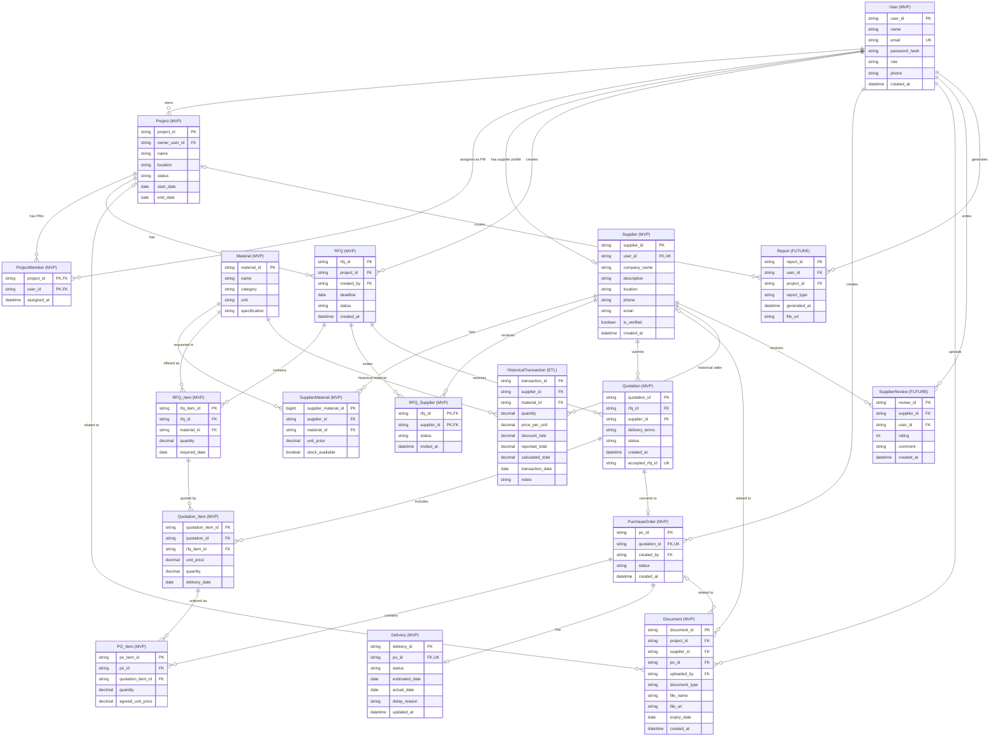
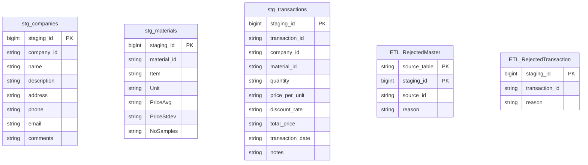
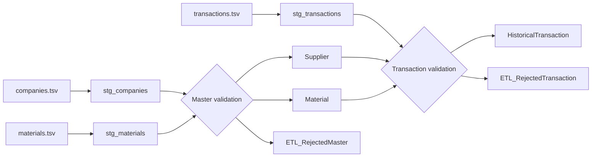

# SUPPLIX — Database Architecture and Entity–Relationship Model (3NF)

## Overview

This document specifies the relational database architecture implemented for SUPPLIX, a web-based construction material supplier and procurement management platform. The current MySQL deployment uses the schema `SUPPLIX_A3_SUBMISSION`, and the application data model follows Third Normal Form (3NF) design principles. It supports the five MVP features: Supplier Directory, Quote Request & Comparison, Order Management, Delivery Tracking, and Document Vault.

The model separates shared material specifications from supplier-specific listings, supports multi-item quotation requests and quotations, and avoids storing project and supplier information redundantly in purchase orders.

The implementation contains **21 physical tables**: **15 MVP application tables**, **1 historical transaction table**, **3 raw staging tables**, and **2 ETL rejection tables**. Two future entities and one future reporting view are conceptual only.

## Scope Legend

- 🟢 **MVP** — Required for the initial MVP release.
- 🔵 **FUTURE** — Planned for later development, not created in SQL.
- 🟠 **DATA INTEGRATION / HISTORICAL** — Implemented tables supporting source-data ingestion, validation, auditability, and historical transaction analysis.
- **PK** — Primary key.
- **FK** — Foreign key.
- **UNIQUE** — Unique constraint.
- Cardinalities describe allowable stored records. Requirements that depend on workflow state, such as an issued purchase order having at least one item, are specified separately as business rules.

## Normalization Notes (3NF)

The application schema was designed using Third Normal Form (3NF) principles: attributes are atomic, and the intended non-key dependencies are on candidate keys rather than other non-key attributes. This is a design rationale, not a formal proof that every table is in 3NF. A formal verification would require validating candidate keys and functional dependencies against the final business rules. HistoricalTransaction intentionally preserves a source-reported total for audit purposes, while calculated_total is generated rather than independently entered. Raw staging tables intentionally preserve denormalized source records and are **outside the normalized application model**.

- Supplier company details (including imported company contact email) are stored in `Supplier`, not repeated in `SupplierMaterial`, `Quotation`, or `PurchaseOrder`.
- Shared material descriptions are stored in `Material`. Supplier-specific catalog prices and availability are stored in `SupplierMaterial`.
- RFQ recipients are represented by `RFQ_Supplier` instead of a direct many-to-many relationship.
- Quotation header data is stored in `Quotation`, while per-material quantities, prices, and proposed delivery dates are stored in `Quotation_Item`.
- `PurchaseOrder` references an accepted quotation. Its project and supplier are determined through `Quotation` and `RFQ`, rather than duplicated in `PurchaseOrder`.
- `PO_Item.agreed_unit_price` represents the agreed contractual price for that order line, which may be retained as a historical transaction value. Calculated subtotals and order totals are not stored as independent base-table attributes. `HistoricalTransaction.calculated_total` is a database-generated column, not an independently editable value.
- Supplier performance statistics are computed from transaction records for reporting rather than duplicated in an editable base table.

These are design-level normalization decisions. Database implementation must additionally enforce the constraints and cross-table consistency rules described below.

## Many-to-Many Relationships

| Relationship | Junction Table | Purpose |
|---|---|---|
| `RFQ` ↔ `Supplier` | `RFQ_Supplier` | Track suppliers invited to each RFQ |
| `Supplier` ↔ `Material` | `SupplierMaterial` | Track supplier-specific listings, prices, and stock availability |
| `Project` ↔ `User` (PM access) | `ProjectMember` | Assign project managers to projects |

---

## Entity Definitions

### 🟢 MVP Entities

#### User

| Attribute | Type | Constraint | Description |
|---|---|---|---|
| `user_id` | VARCHAR(20) | PK | Unique user identifier |
| `name` | VARCHAR | NOT NULL | Full name |
| `email` | VARCHAR | NOT NULL, UNIQUE | Login email |
| `password_hash` | VARCHAR | NOT NULL | Secure password hash |
| `role` | ENUM | NOT NULL | GC / Supplier / PM |
| `phone` | VARCHAR | | Contact number |
| `created_at` | DATETIME | NOT NULL | Registration timestamp |

#### Project

| Attribute | Type | Constraint | Description |
|---|---|---|---|
| `project_id` | VARCHAR(20) | PK | Unique project identifier |
| `owner_user_id` | VARCHAR(20) | NOT NULL, FK → User | GC who owns the project |
| `name` | VARCHAR | NOT NULL | Project name |
| `location` | VARCHAR | | Project site location |
| `status` | ENUM | NOT NULL | active / completed |
| `start_date` | DATE | | Project start date |
| `end_date` | DATE | | Project end date |

#### ProjectMember

| Attribute | Type | Constraint | Description |
|---|---|---|---|
| `project_id` | VARCHAR(20) | PK, FK → Project | Assigned project |
| `user_id` | VARCHAR(20) | PK, FK → User | Assigned PM |
| `assigned_at` | DATETIME | NOT NULL | Assignment timestamp |

**Primary Key:** (`project_id`, `user_id`)

#### Supplier

| Attribute | Type | Constraint | Description |
|---|---|---|---|
| `supplier_id` | VARCHAR(20) | PK | Unique supplier identifier |
| `user_id` | VARCHAR(20) | NULL, UNIQUE, FK → User | Optional linked Supplier-role account; imported companies may not have a login |
| `company_name` | VARCHAR | NOT NULL | Company name |
| `description` | TEXT | | Company description |
| `location` | VARCHAR | | Service area |
| `phone` | VARCHAR | | Company phone |
| `email` | VARCHAR(200) | NULL | Imported company contact email, distinct from User login email |
| `is_verified` | BOOLEAN | NOT NULL, DEFAULT FALSE | Verified badge is shown only after an authorized credential review |
| `created_at` | DATETIME | NOT NULL | Profile creation timestamp |

#### Material

| Attribute | Type | Constraint | Description |
|---|---|---|---|
| `material_id` | VARCHAR(20) | PK | Unique material specification identifier |
| `name` | VARCHAR | NOT NULL | Material name |
| `category` | VARCHAR(100) | NULL | Category unavailable in source TSV; can be enriched later |
| `unit` | VARCHAR | NOT NULL | Unit of measurement |
| `specification` | TEXT | | Common material specification |

#### SupplierMaterial

| Attribute | Type | Constraint | Description |
|---|---|---|---|
| `supplier_material_id` | BIGINT AUTO_INCREMENT | PK | Unique supplier listing identifier |
| `supplier_id` | VARCHAR(20) | NOT NULL, FK → Supplier | Listing supplier |
| `material_id` | VARCHAR(20) | NOT NULL, FK → Material | Listed material specification |
| `unit_price` | DECIMAL | NOT NULL | Current catalog unit price |
| `stock_available` | BOOLEAN | NOT NULL | Current availability |

**Constraint:** `UNIQUE(supplier_id, material_id)` for one current listing per supplier and material specification.

#### RFQ

| Attribute | Type | Constraint | Description |
|---|---|---|---|
| `rfq_id` | VARCHAR(20) | PK | Unique RFQ identifier |
| `project_id` | VARCHAR(20) | NOT NULL, FK → Project | Related project |
| `created_by` | VARCHAR(20) | NOT NULL, FK → User | Project-owning GC in MVP; authorized PM creation is FUTURE |
| `deadline` | DATE | NOT NULL | Quote submission deadline |
| `status` | ENUM | NOT NULL | draft / open / closed |
| `created_at` | DATETIME | NOT NULL | Creation timestamp |

#### RFQ_Supplier

| Attribute | Type | Constraint | Description |
|---|---|---|---|
| `rfq_id` | VARCHAR(20) | PK, FK → RFQ | Related RFQ |
| `supplier_id` | VARCHAR(20) | PK, FK → Supplier | Invited supplier |
| `status` | ENUM | NOT NULL | invited / responded / declined |
| `invited_at` | DATETIME | NOT NULL | Invitation timestamp |

**Primary Key:** (`rfq_id`, `supplier_id`)

#### RFQ_Item

| Attribute | Type | Constraint | Description |
|---|---|---|---|
| `rfq_item_id` | VARCHAR(20) | PK | Unique requested line identifier |
| `rfq_id` | VARCHAR(20) | NOT NULL, FK → RFQ | Related RFQ |
| `material_id` | VARCHAR(20) | NOT NULL, FK → Material | Requested material specification |
| `quantity` | DECIMAL | NOT NULL | Requested quantity |
| `required_date` | DATE | | Required delivery date |

#### Quotation

| Attribute | Type | Constraint | Description |
|---|---|---|---|
| `quotation_id` | VARCHAR(20) | PK | Unique quotation identifier |
| `rfq_id` | VARCHAR(20) | NOT NULL, FK → RFQ | Related RFQ |
| `supplier_id` | VARCHAR(20) | NOT NULL, FK → Supplier | Quoting supplier |
| `delivery_terms` | TEXT | | General delivery conditions |
| `status` | ENUM | NOT NULL | pending / accepted / rejected |
| `created_at` | DATETIME | NOT NULL | Submission timestamp |
| `accepted_rfq_id` | VARCHAR(20) | GENERATED, UNIQUE | RFQ ID only when quotation is accepted; otherwise NULL |

**Constraints:**

- `UNIQUE(rfq_id, supplier_id)` ensures that each supplier submits at most one quotation per RFQ.
- `(rfq_id, supplier_id)` must reference an existing `RFQ_Supplier` invitation.
- At most one quotation per RFQ may have `status = accepted` in the MVP.
- Conditional uniqueness must be enforced using an appropriate database index, trigger, or transactional validation.

#### Quotation_Item

| Attribute | Type | Constraint | Description |
|---|---|---|---|
| `quotation_item_id` | VARCHAR(20) | PK | Unique quoted line identifier |
| `quotation_id` | VARCHAR(20) | NOT NULL, FK → Quotation | Related quotation |
| `rfq_item_id` | VARCHAR(20) | NOT NULL, FK → RFQ_Item | Requested line being quoted |
| `unit_price` | DECIMAL | NOT NULL | Quoted unit price |
| `quantity` | DECIMAL | NOT NULL | Offered quantity |
| `delivery_date` | DATE | NOT NULL | Proposed delivery date for this line |

**Constraint:** `UNIQUE(quotation_id, rfq_item_id)`; the referenced RFQ item must belong to the quotation's RFQ.

#### PurchaseOrder

| Attribute | Type | Constraint | Description |
|---|---|---|---|
| `po_id` | VARCHAR(20) | PK | Unique purchase order identifier |
| `quotation_id` | VARCHAR(20) | NOT NULL, UNIQUE, FK → Quotation | Accepted quotation used for this PO |
| `created_by` | VARCHAR(20) | NOT NULL, FK → User | Project-owning GC in MVP; additional authorized roles are FUTURE |
| `status` | ENUM | NOT NULL | draft / pending / accepted / rejected / in_progress / fulfilled |
| `created_at` | DATETIME | NOT NULL | Creation timestamp |

**Note:** The PO's project is obtained through `Quotation → RFQ → Project`; its supplier is obtained through `Quotation → Supplier`. `draft` represents an order being prepared, while `pending` represents an issued order awaiting supplier confirmation. A rejected order cannot proceed to fulfillment without a new valid approval process.

#### PO_Item

| Attribute | Type | Constraint | Description |
|---|---|---|---|
| `po_item_id` | VARCHAR(20) | PK | Unique purchase order line identifier |
| `po_id` | VARCHAR(20) | NOT NULL, FK → PurchaseOrder | Related PO |
| `quotation_item_id` | VARCHAR(20) | NOT NULL, FK → Quotation_Item | Accepted quoted line |
| `quantity` | DECIMAL | NOT NULL | Ordered quantity |
| `agreed_unit_price` | DECIMAL | NOT NULL | Contractually agreed unit price |

**Constraint:** `UNIQUE(po_id, quotation_item_id)`; the quotation item must belong to the PO's accepted quotation. `subtotal = quantity × agreed_unit_price` is calculated when needed.

#### Delivery

| Attribute | Type | Constraint | Description |
|---|---|---|---|
| `delivery_id` | VARCHAR(20) | PK | Unique delivery identifier |
| `po_id` | VARCHAR(20) | NOT NULL, UNIQUE, FK → PurchaseOrder | Related PO |
| `status` | ENUM | NOT NULL | dispatched / out_for_delivery / delivered / delayed |
| `estimated_date` | DATE | NOT NULL | Expected delivery date |
| `actual_date` | DATE | | Actual delivery date |
| `delay_reason` | TEXT | | Reason for delay if applicable |
| `updated_at` | DATETIME | NOT NULL | Last update timestamp |

#### Document

| Attribute | Type | Constraint | Description |
|---|---|---|---|
| `document_id` | VARCHAR(20) | PK | Unique document identifier |
| `project_id` | VARCHAR(20) | NULL, FK → Project | Related project, if applicable |
| `supplier_id` | VARCHAR(20) | NULL, FK → Supplier | Related supplier, if applicable |
| `po_id` | VARCHAR(20) | NULL, FK → PurchaseOrder | Related PO, if applicable |
| `uploaded_by` | VARCHAR(20) | NOT NULL, FK → User | User who uploaded the document |
| `document_type` | ENUM | NOT NULL | certificate / invoice / safety_sheet / contract |
| `file_name` | VARCHAR | NOT NULL | File name |
| `file_url` | VARCHAR | NOT NULL | File storage path |
| `expiry_date` | DATE | | Document expiry date |
| `created_at` | DATETIME | NOT NULL | Upload timestamp |

**Constraint:** At least one of `project_id`, `supplier_id`, or `po_id` must be non-NULL. When multiple references are provided, they must be consistent with the linked procurement records.

### 🟠 Historical Data and Integration Tables (implemented in SQL)

These six tables are **implemented in the database** alongside the 15 MVP application tables to support historical data integration, quality control, and auditability. The three `stg_*` tables preserve source fields without enforcing application-level 3NF. Rejection tables document records not loaded into normalized master or transaction tables.

#### HistoricalTransaction

| Attribute | SQL Type | Constraint / Meaning |
|---|---|---|
| `transaction_id` | VARCHAR(20) | PK |
| `supplier_id` | VARCHAR(20) | NOT NULL, FK → Supplier |
| `material_id` | VARCHAR(20) | NOT NULL, FK → Material |
| `quantity` | DECIMAL(18,4) | NOT NULL, positive |
| `price_per_unit` | DECIMAL(18,4) | NOT NULL, nonnegative |
| `discount_rate` | DECIMAL(9,4) | NOT NULL, between 0 and 100 |
| `reported_total` | DECIMAL(20,4) | Nullable source-reported total |
| `calculated_total` | DECIMAL(20,4) | STORED generated column: rounded quantity × price × (1 − discount/100) |
| `transaction_date` | DATE | Nullable |
| `notes` | TEXT | Nullable |

A historical source transaction is **not** assumed to be an application `PurchaseOrder`. The reported total is preserved for audit/comparison; differences from the generated total are source-data quality observations, not necessarily rejected transactions.

#### stg_materials

`staging_id BIGINT AUTO_INCREMENT PK`, `material_id VARCHAR(20)`, `Item TEXT`, `Unit VARCHAR(50)`, `PriceAvg VARCHAR(100)`, `PriceStdev VARCHAR(100)`, `NoSamples VARCHAR(100)`.

#### stg_companies

`staging_id BIGINT AUTO_INCREMENT PK`, `company_id VARCHAR(20)`, `name VARCHAR(200)`, `description TEXT`, `address TEXT`, `phone VARCHAR(100)`, `email VARCHAR(200)`, `comments TEXT`.

#### stg_transactions

`staging_id BIGINT AUTO_INCREMENT PK`, `transaction_id VARCHAR(20)`, `company_id VARCHAR(20)`, `material_id VARCHAR(20)`, `quantity VARCHAR(100)`, `price_per_unit VARCHAR(100)`, `discount_rate VARCHAR(100)`, `total_price VARCHAR(100)`, `transaction_date VARCHAR(100)`, `notes TEXT`.

#### ETL_RejectedMaster

`source_table VARCHAR(30)` + `staging_id BIGINT` form the composite PK; `source_id VARCHAR(20)` and `reason VARCHAR(255) NOT NULL` record rejected company/material rows.

#### ETL_RejectedTransaction

`staging_id BIGINT PK`, `transaction_id VARCHAR(20)`, `reason VARCHAR(255) NOT NULL` record rejected source transactions.

**ETL lineage:** `stg_companies → Supplier`, `stg_materials → Material`, and `stg_transactions → HistoricalTransaction`; invalid records are recorded in the corresponding rejection table. These are transformation flows, **not foreign-key relationships**.

**Database initialization and data-import verification:** 21 tables, 17 triggers; 500 suppliers, 458 materials; 51,947 raw transactions = 46,835 accepted + 5,112 rejected (`difference = 0`).

### 🔵 Future Entities

#### SupplierReview

| Attribute | Type | Constraint | Description |
|---|---|---|---|
| `review_id` | VARCHAR(20) | PK | Unique review identifier |
| `supplier_id` | VARCHAR(20) | NOT NULL, FK → Supplier | Reviewed supplier |
| `user_id` | VARCHAR(20) | NOT NULL, FK → User | GC who wrote the review |
| `rating` | INT | NOT NULL, CHECK 1–5 | Rating score |
| `comment` | TEXT | | Review comment |
| `created_at` | DATETIME | NOT NULL | Review timestamp |

#### Report

| Attribute | Type | Constraint | Description |
|---|---|---|---|
| `report_id` | VARCHAR(20) | PK | Unique report identifier |
| `user_id` | VARCHAR(20) | NOT NULL, FK → User | GC or PM who generated the report |
| `project_id` | VARCHAR(20) | NULL, FK → Project | Related project, if applicable |
| `report_type` | ENUM | NOT NULL | procurement / performance |
| `generated_at` | DATETIME | NOT NULL | Generation timestamp |
| `file_url` | VARCHAR | NOT NULL | Generated report location |

#### SupplierPerformance (Future Reporting View)

`SupplierPerformance` is a **derived reporting view**, not a base table. It may expose `supplier_id`, `total_orders`, `completed_orders`, `on_time_delivery_rate`, and other metrics calculated from `PurchaseOrder` and `Delivery`.

A quality-issue metric requires an additional, explicitly defined quality-issue data source in a future release; it cannot be reliably calculated from the current MVP schema.

---

## Business Rules

### User & Access

- Each User has exactly one role: GC, Supplier, or PM.
- Imported Supplier profiles may have `user_id = NULL`. Once an application Supplier account is linked, the referenced User must have the Supplier role; one account may link to at most one profile. Full registration completeness is an application/workflow requirement.
- Each Supplier profile has zero or one linked User account in the implemented database (zero for unregistered imported companies).
- In the MVP, a PM can read procurement records only for Projects assigned through `ProjectMember`; PMs cannot create RFQs, create or approve POs, or confirm deliveries. Any broader PM permissions are FUTURE.
- `ProjectMember.user_id` must reference a User with the PM role.

### Project

- Each Project is owned by exactly one GC.
- A GC can own multiple Projects.
- Project start and end dates must be chronologically consistent when both are supplied.

### Supplier & Material

- A Supplier may list multiple Materials through `SupplierMaterial`.
- A Material specification may be offered by multiple Suppliers.
- Each SupplierMaterial listing belongs to exactly one Supplier and one Material.
- Supplier verification requires supporting credentials and an authorized review decision; uploading credentials alone never grants a verified badge.
- In the MVP, credential documents can be stored in `Document`, and `Supplier.is_verified` is updated by an authorized administrative/back-office process; no separate admin user role or verification-history table is modeled.

### RFQ & Quotation

- Each RFQ belongs to one Project. In the MVP, only the GC who owns that Project may create or send its RFQs; PM-initiated RFQs are FUTURE.
- A draft RFQ may have no items or invited suppliers; before it is opened or sent, it must have at least one `RFQ_Item` and at least one invited supplier.
- An RFQ may be sent to multiple Suppliers; invitations are unique per `(rfq_id, supplier_id)`.
- Each RFQ_Item references a shared Material specification rather than a specific supplier listing.
- Only Suppliers with a matching `RFQ_Supplier` invitation may submit quotations for an open RFQ before its deadline. A quotation must contain items from that same RFQ.
- A Supplier may submit at most one Quotation per RFQ.
- A submitted Quotation must have at least one Quotation_Item; each quoted item must belong to the same RFQ as the quotation.
- A Quotation_Item specifies the offered quantity, unit price, and proposed delivery date for a requested line.
- In this MVP workflow, at most one Quotation can be accepted for an RFQ; acceptance must be enforced atomically. Partial or multi-supplier awards would require additional design.

### Purchase Order

- Each PurchaseOrder is based on exactly one accepted Quotation and is created by the owning GC in the MVP.
- An accepted Quotation can produce at most one PurchaseOrder.
- The Project and Supplier of a PurchaseOrder are determined by its referenced Quotation and RFQ.
- A draft PurchaseOrder may temporarily have no PO_Item. Before transitioning to `pending` and being issued to a Supplier, it must contain at least one PO_Item.
- Each PO_Item must reference a Quotation_Item belonging to the PO's Quotation.
- Ordered quantities must be positive and must not exceed the accepted quoted quantities unless the quotation is revised.
- The Supplier may accept or reject an issued PO. Only accepted orders may move to `in_progress` and then `fulfilled`.
- A rejected PO cannot be moved directly to `in_progress` or `fulfilled`.
- `PO_Item.agreed_unit_price` records the agreed price for that order line; subtotals and totals are calculated from PO items.

### Delivery

- Each PurchaseOrder can have zero or one Delivery record while it is being prepared; once fulfillment begins, a Delivery record is required.
- `Delivery.po_id` is unique, preventing multiple Delivery records for the same PO in the MVP.
- Split shipments and multiple deliveries per PO are outside the MVP scope.
- The fulfilling Supplier is responsible for delivery status updates.
- Delayed deliveries should include a delay reason; delivered records should include an actual delivery date.
- Dashboard alerts are derived from delivery statuses and estimated dates; no Notification table is required in the MVP.

### Document

- A Document must be linked to at least one Project, Supplier, or PurchaseOrder.
- A Document may be linked to more than one of these entities when the references are mutually consistent.
- If `po_id` and `project_id` are both provided, the Project must match the PO's Project.
- If `po_id` and `supplier_id` are both provided, the Supplier must match the PO's Supplier.
- Only authorized users may upload or access documents associated with a project or supplier.
- Expiry alerts apply only to documents with a specified expiry date.
- Dashboard alerts are calculated from stored expiry dates; notification history, email, and push delivery are FUTURE.

### Future Rules

- A SupplierReview can be written only by a GC with at least one completed order involving the reviewed Supplier.
- Supplier performance metrics are calculated from procurement and delivery records; additional quality metrics require a defined quality-issue data source.
- Reports can be generated by authorized GC or PM users.

### Implementation Constraints

- The SQL implements PK, FK, NOT NULL, UNIQUE, CHECK and 17 triggers for selected rules. Some workflow rules below are **requirements**, not yet enforced by the current database; implement them in application logic or additional database controls before production deployment.
- Validate role-specific restrictions, invited-supplier access, quotation/RFQ item consistency, at-most-one-accepted-quotation rules, PO/quotation item consistency, and cross-entity ownership using transactions, application logic, database constraints, or triggers as appropriate.
- Positive quantities and nonnegative prices should be enforced for RFQ, quotation, supplier listing, and PO items.
- Validate workflow-dependent requirements when records change status, including opening RFQs, accepting quotations, issuing purchase orders, and completing deliveries.

---

## Implemented Trigger Inventory (17 triggers)

The following triggers are defined in the current `SUPPLIX.sql` implementation. Each `BEFORE INSERT` / `BEFORE UPDATE` pair enforces the same rule at both operations, except the final User trigger.

| Table | Trigger(s) | Enforced condition |
|---|---|---|
| `Project` | `trg_project_gc_before_insert`, `trg_project_gc_before_update` | `owner_user_id` must refer to a `GC` user. |
| `Supplier` | `trg_supplier_role_before_insert`, `trg_supplier_role_before_update` | A non-NULL linked `user_id` must refer to a `Supplier` user. |
| `Quotation_Item` | `trg_qi_same_rfq_before_insert`, `trg_qi_same_rfq_before_update` | The quotation and requested line must belong to the same RFQ. |
| `PO_Item` | `trg_poi_same_quote_before_insert`, `trg_poi_same_quote_before_update` | The PO and referenced quotation line must use the same quotation. |
| `ProjectMember` | `trg_pm_role_before_insert`, `trg_pm_role_before_update` | Member user must have the `PM` role. |
| `RFQ` | `trg_rfq_owner_before_insert`, `trg_rfq_owner_before_update` | Creator must be the project's owner and have the `GC` role. |
| `PurchaseOrder` | `trg_po_owner_before_insert`, `trg_po_owner_before_update` | Referenced quotation must be accepted, and creator must own the corresponding project as `GC`. |
| `PO_Item` | `trg_poi_quantity_before_insert`, `trg_poi_quantity_before_update` | Ordered quantity cannot exceed the quotation item's quantity. |
| `User` | `trg_user_role_before_update` | Prevent role changes while dependent project, membership, supplier, RFQ, or PO records exist. |

**Other SQL-enforced constraints:** `Quotation.accepted_rfq_id` is a *STORED generated column* with a UNIQUE key that permits at most one accepted quotation per RFQ. `HistoricalTransaction.calculated_total` is also a STORED generated column. `Delivery.po_id` and `PurchaseOrder.quotation_id` are UNIQUE. `Document` requires at least one of `project_id`, `supplier_id`, and `po_id` to be non-NULL.

## Implementation Fidelity and Remaining Business Rules

The SQL currently checks GC ownership for Project, RFQ and PurchaseOrder creation/updates; Supplier and ProjectMember role compatibility; cross-RFQ quotation items; cross-quotation PO items; PO item quantity bounds; and certain role changes. It also enforces at most one accepted quotation per RFQ using a generated column plus UNIQUE index.

**Not all stated business rules are implemented as database constraints.** In particular, workflow status transitions, minimum item counts at issuance, some cross-reference consistency and authorization checks, and changes to already referenced parent records require further application/transaction validation. The ER diagram expresses the intended domain model, not proof of enforcement of every business rule.

## ER Diagram

The main diagram displays the 15 MVP tables, the historical transaction table, and conceptual future entities. Raw staging and rejection tables are documented above and illustrated separately in an ETL lineage diagram because their relationships are transformation flows, **not declared foreign keys**.

### Scope Summary

| Scope | Entities |
|---|---|
| 🟠 **HISTORICAL / ETL** | `HistoricalTransaction` `stg_materials` `stg_companies` `stg_transactions` `ETL_RejectedMaster` `ETL_RejectedTransaction` |
| 🟢 **MVP** | `User` `Project` `ProjectMember` `Supplier` `Material` `SupplierMaterial` `RFQ` `RFQ_Supplier` `RFQ_Item` `Quotation` `Quotation_Item` `PurchaseOrder` `PO_Item` `Delivery` `Document` |
| 🔵 **FUTURE** | `SupplierReview` `Report`; `SupplierPerformance` (derived reporting view) |

> **Scope Legend:** Entities labeled `(MVP)` and `(FUTURE)` in the ER Diagram indicate the development scope. All attributes within MVP entities belong to the MVP scope, while all attributes within FUTURE entities are reserved for future development. The six ETL/historical tables are implemented separately for data ingestion and audit. `SupplierPerformance` is a FUTURE reporting view and is not represented as a base table.

## Data Integration Table Structure (physical tables without declared foreign keys)

The five persistent data-integration support tables are part of the 21-table physical database. They are **not** connected by declared SQL foreign keys to the application tables. `staging_id` and `source_id` are traceability fields, not automatically FK constraints. The following diagram documents their physical columns; the subsequent diagram illustrates the data-ingestion flow.

## Data Integration and ETL Lineage (not an FK ER diagram)

The following shows the import and transformation paths implemented in the SUPPLIX database initialization and data-integration SQL. Arrows indicate ETL operations rather than relational constraints. Temporary `etl_tx_parsed` and `etl_tx_review` tables are created and dropped during the script, so they are **not** counted among the 21 persistent tables.

**Data-import reconciliation:** 51,947 staged transactions = 46,835 accepted historical transactions + 5,112 rejected transactions; reconciliation difference 0. This establishes row-count reconciliation, not complete validation of all possible application workflows.
