# construction-supplier-management-SUPPLIX
Construction Material Supplier Management Web Application

## 1. Project Overview

SUPPLIX is a web-based platform designed to improve construction material supplier management and procurement activities.

The platform connects general contractors, material suppliers, and project managers in a centralized system. It aims to simplify supplier discovery, quotation comparison, order management, delivery tracking, and procurement document management.

### Main User Roles

- **General Contractor (GC):** Searches for suppliers, requests and compares quotations, manages purchase orders, and monitors deliveries.
- **Supplier:** Maintains company information, responds to quotation requests, confirms orders, updates delivery status, and uploads documents.
- **Project Manager (PM):** Reviews suppliers and quotations, monitors purchase orders, tracks deliveries, and accesses procurement documents.

## 2. Website Organization Chart

The following diagram illustrates the proposed website structure based on three user roles and five core MVP features.

```mermaid
flowchart TD
    A["Homepage"]
    B["Login / Register"]
    C["General Contractor Dashboard"]
    D["Supplier Dashboard"]
    E["Project Manager Dashboard"]

    A --> B
    B --> C
    B --> D
    B --> E

    C --> F["Supplier Directory"]
    C --> G["Quote Request & Comparison"]
    C --> H["Order Management"]
    C --> I["Delivery Tracking"]
    C --> J["Document Vault"]

    F --> F1["Search & Filter Suppliers"]
    F --> F2["View Supplier Profiles"]

    G --> G1["Create & Send RFQs"]
    G --> G2["Compare Supplier Quotations"]

    H --> H1["Create Purchase Orders"]
    H --> H2["View Order Status"]

    I --> I1["Monitor Deliveries"]
    I --> I2["Delivery Notifications"]

    J --> J1["Upload Documents"]
    J --> J2["View & Download Documents"]

    D --> K["Manage Supplier Profile"]
    D --> L["Respond to RFQs"]
    D --> M["Confirm Purchase Orders"]
    D --> N["Update Delivery Status"]
    D --> O["Upload Supplier Documents"]

    E --> P["Review Suppliers & Quotations"]
    E --> Q["Monitor Purchase Orders"]
    E --> R["Track Material Deliveries"]
    E --> S["Access Procurement Documents"]

    classDef high fill:#D5F5E3,stroke:#239B56,color:#145A32
    classDef medium fill:#FCF3CF,stroke:#D4AC0D,color:#7D6608
    classDef low fill:#D6EAF8,stroke:#2980B9,color:#154360

    class A,B,C,D,E,F,F1,F2,G,G1,G2,K,L,P high
    class H,H1,H2,I,I1,I2,J,J1,J2,M,N,O,Q,R,S medium
```

## 3. Implementation Priorities

The website development will follow a phased implementation approach.

### High Priority - Green

- Homepage and user authentication
- User dashboards
- Supplier Directory
- Supplier search and profile viewing
- RFQ creation and submission
- Quotation comparison
- Supplier profile management
- Supplier quotation responses

### Medium Priority - Yellow

- Purchase order creation and management
- Order confirmation and monitoring
- Delivery tracking and notifications
- Procurement document management
- Supplier document uploads
- Project manager monitoring functions

### Low Priority - Blue

Future enhancements may include:

- Advanced supplier performance analytics
- Advanced procurement reporting
- Additional system integrations

**Note:** All five core modules are required for the MVP. The priority colors indicate the proposed implementation sequence, not the exclusion of any MVP feature. Low-priority enhancements are outside the initial MVP scope.

## 4. Minimum Viable Product (MVP)

Based on the business proposal, SUPPLIX includes five essential MVP features:

| No. | MVP Feature | Main Functions |
|---|---|---|
| 1 | Supplier Directory | Search suppliers, filter results, view profiles and certifications |
| 2 | Quote Request & Comparison | Send RFQs to multiple suppliers and compare quotations |
| 3 | Order Management | Create purchase orders, confirm orders, and monitor order status |
| 4 | Delivery Tracking | Monitor expected deliveries, update delivery status, and receive delay notifications |
| 5 | Document Vault | Upload, organize, access, and manage procurement documents |

### Main Procurement Workflow

Find Suppliers → Request Quotations → Compare Quotations → Place Orders → Track Deliveries → Manage Documents

## 5. Team Responsibilities

The website planning and development tasks are divided between two team members.

| Team Member | Assigned Responsibilities |
|---|---|
| Dau Thuy Dung | Homepage, Login/Register, General Contractor Dashboard, Supplier Directory, Quote Request & Comparison |
| Member 2 | Supplier Dashboard, Project Manager Dashboard, Order Management, Delivery Tracking, Document Vault |

Both members will collaborate on reviewing the website organization chart, implementation priorities, and overall system integration.

## 6. Development Plan

### Phase 1: Website Structure and Core Procurement Functions

- Design the homepage and authentication pages.
- Create role-based dashboards.
- Develop the supplier directory.
- Implement supplier search and profile management.
- Develop RFQ submission and quotation comparison.

### Phase 2: Order, Delivery, and Document Management

- Implement purchase order management.
- Enable supplier order confirmation.
- Develop delivery tracking and notifications.
- Implement document upload and management.
- Support project manager monitoring functions.

### Phase 3: Future Enhancements

- Supplier performance analytics.
- Advanced procurement reports.
- Additional integrations and system improvements.

## 7. Project Status

Current stage: Website planning and organization design.

This repository documents the proposed website structure, implementation priorities, and team responsibilities before system development begins.

