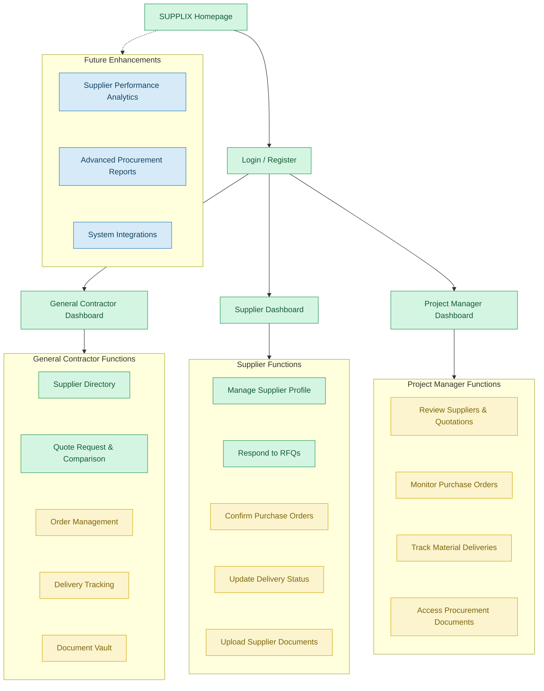
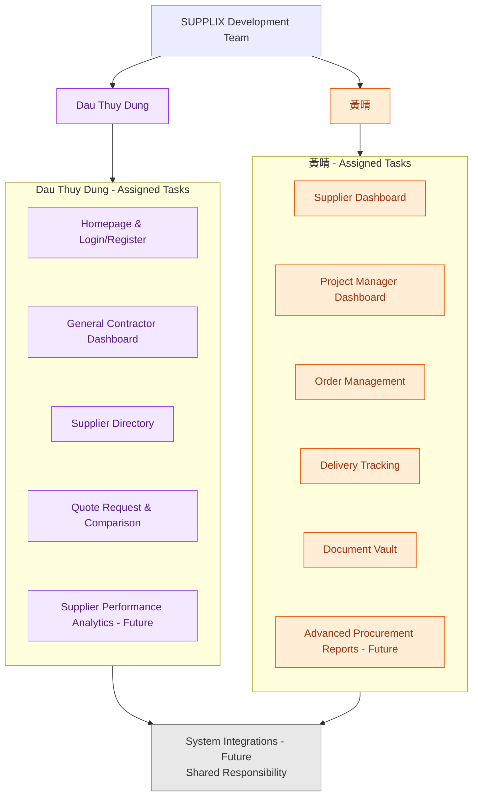

# construction-supplier-management-SUPPLIX
Construction Material Supplier Management Web Application

## 1. Project Overview

SUPPLIX is a web-based platform designed to improve construction material supplier management and procurement activities.

The platform connects general contractors, material suppliers, and project managers in a centralized system. It aims to simplify supplier discovery, quotation comparison, order management, delivery tracking, and procurement document management.

### Main User Roles

- **General Contractor (GC):** Searches for suppliers, requests and compares quotations, manages purchase orders, and monitors deliveries.
- **Supplier:** Maintains company information, responds to quotation requests, confirms orders, updates delivery status, and uploads documents.
- **Project Manager (PM):** Reviews suppliers and quotations, monitors purchase orders, tracks deliveries, and accesses procurement documents.

## 2. Website Organization Chart

The following diagrams illustrate the proposed website structure, implementation priorities, and team responsibilities.

### 2.1. Website Structure and Implementation Priorities

The website is organized around three user roles and five essential MVP features. Different colors indicate the proposed implementation priorities.

**Implementation Priority Legend:**

- **Green – High Priority:** Homepage, user authentication, dashboards, supplier directory, RFQ management, and quotation comparison.
- **Yellow – Medium Priority:** Order management, delivery tracking, document management, and supporting project manager functions.
- **Blue – Low Priority:** Future enhancements, including supplier performance analytics, advanced reporting, and system integrations.

### 2.2. Team Responsibility Chart

The following diagram illustrates the tasks assigned to each team member, including planned future enhancements.

**Team Responsibility Legend:**

- **Purple:** Dau Thuy Dung
- **Orange:** 黃晴
- **Gray:** Shared responsibility

The colors in Section 2.1 represent implementation priorities, while the colors in Section 2.2 identify responsible team members.

Future enhancements are assigned for planning purposes and are not part of the initial MVP development scope.

## 3. Implementation Priorities

The website development will follow a phased implementation approach.

### High Priority - Green

- Homepage and user authentication
- User dashboards
- Supplier Directory
- Supplier search and profile viewing
- RFQ creation and submission
- Quotation comparison
- Supplier profile management
- Supplier quotation responses

### Medium Priority - Yellow

- Purchase order creation and management
- Order confirmation and monitoring
- Delivery tracking and notifications
- Procurement document management
- Supplier document uploads
- Project manager monitoring functions

### Low Priority - Blue

Future enhancements may include:

- Advanced supplier performance analytics
- Advanced procurement reporting
- Additional system integrations

## 4. Use Cases

The following use cases are derived from the business proposal and user stories. Each use case is tagged to indicate whether it is part of the **MVP** or the **Full Product** scope.

- 🟢 `[MVP]` — Required for the initial launch
- 🔵 `[FUTURE]` — Planned for future development

---

### 4.1 Supplier Directory

| Use Case | Actor | Tag |
|---|---|---|

| Search and filter suppliers by material type and location | General Contractor | 🟢 `[MVP]` |
| View supplier profile with certifications and contact details | General Contractor | 🟢 `[MVP]` |
| Save suppliers to a preferred list | General Contractor | 🔵 `[FUTURE]` |
| View supplier's previous transaction history | General Contractor | 🔵 `[FUTURE]` |
| Create and manage a public supplier profile | Supplier | 🟢 `[MVP]` |
| Receive a verified badge after submitting credentials | Supplier | 🟢 `[MVP]` |
| Update contact information and service area | Supplier | 🟢 `[MVP]` |
| Browse and shortlist suppliers for a project | Project Manager | 🔵 `[FUTURE]` |
| Organize suppliers by material category | Project Manager | 🔵 `[FUTURE]` |

---

### 4.2 Quote Request & Comparison

| Use Case | Actor | Tag |
|---|---|---|
| Send RFQ to multiple suppliers simultaneously | General Contractor | 🟢 `[MVP]` |
| Compare quotes side by side on price, lead time, and delivery terms | General Contractor | 🟢 `[MVP]` |
| Set a deadline for quote submissions | General Contractor | 🟢 `[MVP]` |
| View status of quote requests | General Contractor | 🟢 `[MVP]` |
| Receive RFQ notifications for carried materials | Supplier | 🟢 `[MVP]` |
| Submit a detailed quote with unit price, quantity, and delivery date | Supplier | 🟢 `[MVP]` |
| Update or withdraw a quotation before acceptance | Supplier | 🔵 `[FUTURE]` |
| View status of submitted quotations | Supplier | 🔵 `[FUTURE]` |
| Initiate RFQ on behalf of general contractor | Project Manager | 🔵 `[FUTURE]` |
| View supplier quotations for assigned projects | Project Manager | 🟢 `[MVP]` |

---

### 4.3 Order Management

| Use Case | Actor | Tag |
|---|---|---|
| Convert accepted quote into a purchase order | General Contractor | 🟢 `[MVP]` |
| View all active and past purchase orders on a dashboard | General Contractor | 🟢 `[MVP]` |
| Receive confirmation when supplier accepts purchase order | General Contractor | 🟢 `[MVP]` |
| Update order status | General Contractor | 🟢 `[MVP]` |
| Receive and view all incoming purchase orders | Supplier | 🟢 `[MVP]` |
| Confirm or reject a purchase order | Supplier | 🟢 `[MVP]` |
| Flag order as accepted, in-progress, or fulfilled | Supplier | 🟢 `[MVP]` |
| Attach invoice directly to a fulfilled order | Supplier | 🔵 `[FUTURE]` |
| Review and approve purchase orders before sending to supplier | Project Manager | 🔵 `[FUTURE]` |
| Receive alerts when order total approaches budget threshold | Project Manager | 🔵 `[FUTURE]` |
| View purchase orders for assigned projects | Project Manager | 🟢 `[MVP]` |

---

### 4.4 Delivery Tracking

| Use Case | Actor | Tag |
|---|---|---|
| View expected delivery date and current status of every active order | General Contractor | 🟢 `[MVP]` |
| Receive notification when delivery is confirmed or delayed | General Contractor | 🟢 `[MVP]` |
| Log and report a delivery discrepancy | General Contractor | 🔵 `[FUTURE]` |
| Update delivery status of an order | Supplier | 🟢 `[MVP]` |
| Provide an estimated delivery date | Supplier | 🟢 `[MVP]` |
| Upload proof of delivery document or photo | Supplier | 🔵 `[FUTURE]` |
| Report delivery delays | Supplier | 🟢 `[MVP]` |
| View consolidated pending deliveries across active projects | Project Manager | 🔵 `[FUTURE]` |
| Track material deliveries for assigned projects | Project Manager | 🟢 `[MVP]` |
| Confirm that materials have been delivered | Project Manager | 🔵 `[FUTURE]` |

---

### 4.5 Document Vault

| Use Case | Actor | Tag |
|---|---|---|
| Upload and store compliance documents per supplier | General Contractor | 🟢 `[MVP]` |
| Receive alert when supplier certification is nearing expiration | General Contractor | 🟢 `[MVP]` |
| Organize documents by project and supplier | General Contractor | 🟢 `[MVP]` |
| Download stored documents | General Contractor | 🟢 `[MVP]` |
| Upload and manage compliance documents on supplier profile | Supplier | 🟢 `[MVP]` |
| Receive notification when uploaded document is about to expire | Supplier | 🟢 `[MVP]` |
| View documents associated with orders | Supplier | 🔵 `[FUTURE]` |
| Verify all suppliers have valid documentation before work begins | Project Manager | 🔵 `[FUTURE]` |
| Search for documents by project, supplier, or document type | Project Manager | 🔵 `[FUTURE]` |
| View procurement documents for assigned projects | Project Manager | 🟢 `[MVP]` |    

---

### 4.6 Future Enhancements

| Use Case | Actor | Tag |
|---|---|---|
| Supplier performance analytics based on historical data | General Contractor | 🔵 `[FUTURE]` |
| Advanced procurement reports | General Contractor / PM | 🔵 `[FUTURE]` |
| System integrations with external tools | All Users | 🔵 `[FUTURE]` |

---

## 5. Minimum Viable Product (MVP)

Based on the business proposal, SUPPLIX includes five essential MVP features. Each MVP feature must satisfy the following criteria:

- Useful to a contractor on their first login.
- Not replicable with a free tool (e.g. email or spreadsheet).
- Contributes to a complete workflow from supplier discovery through compliance.

| No. | MVP Feature | Main Functions | Scope |
|---|---|---|---|
| 1 | Supplier Directory | Search suppliers, filter results, view profiles and certifications | 🟢 `[MVP]` |
| 2 | Quote Request & Comparison | Send RFQs to multiple suppliers and compare quotations | 🟢 `[MVP]` |
| 3 | Order Management | Create purchase orders, confirm orders, and monitor order status | 🟢 `[MVP]` |
| 4 | Delivery Tracking | Monitor expected deliveries, update delivery status, and receive delay notifications | 🟢 `[MVP]` |
| 5 | Document Vault | Upload, organize, access, and manage procurement documents | 🟢 `[MVP]` |

### Full Product Features (Future Scope)

The following features are planned for future development beyond the MVP:

| No. | Feature | Description | Scope |
|---|---|---|---|
| 1 | Supplier Performance Analytics | Analyze historical supplier data including delivery performance and quality records | 🔵 `[FUTURE]` |
| 2 | Advanced Procurement Reports | Generate detailed procurement reports and analytics | 🔵 `[FUTURE]` |
| 3 | System Integrations | Integrate with external construction management tools | 🔵 `[FUTURE]` |

### Main Procurement Workflow

**MVP Workflow:**

Find Suppliers → Request Quotations → Compare Quotations → Place Orders → Track Deliveries → Manage Documents

## 6. Team Responsibilities

The website planning and development tasks are divided between two team members.

| Team Member | Assigned Responsibilities |
|---|---|
| Dau Thuy Dung | Homepage, Login/Register, General Contractor Dashboard, Supplier Directory, Quote Request & Comparison, Supplier Performance Analytics (Future) |
| 黃晴 | Supplier Dashboard, Project Manager Dashboard, Order Management, Delivery Tracking, Document Vault, Advanced Procurement Reports (Future) |
| Both Members | System Integrations (Future), Website Structure Review, Implementation Planning, and Overall System Integration |

Both members will collaborate on reviewing the website organization chart, implementation priorities, and overall system integration.

Future enhancement responsibilities are preliminary and may be adjusted during later development phases.

## 7. Development Plan

The website development will follow a phased implementation approach. Each phase is tagged to indicate its scope.

### Phase 1: Website Structure and Core Procurement Functions 🟢 `[MVP]`

- Design the homepage and authentication pages.
- Create role-based dashboards.
- Develop the supplier directory.
- Implement supplier search and profile management.
- Develop RFQ submission and quotation comparison.

### Phase 2: Order, Delivery, and Document Management 🟢 `[MVP]`

- Implement purchase order management.
- Enable supplier order confirmation.
- Develop delivery tracking and notifications.
- Implement document upload and management.
- Support project manager monitoring functions.

### Phase 3: Future Enhancements 🔵 `[FUTURE]`

- Develop supplier performance analytics (Dau Thuy Dung).
- Develop advanced procurement reports (黃晴).
- Implement additional system integrations (Both Members).

## 8. Project Status

Current stage: Website planning and organization design.

This repository documents the proposed website structure, implementation priorities, and team responsibilities before system development begins.

## 9. Data Model Documentation

The SUPPLIX ER model is documented in [ERModel.md](ERModel.md).

The ER model includes:
- Entity definitions and attributes supporting the proposed system.
- Primary keys (PK) and foreign keys (FK).
- Entity relationships and cardinality constraints.
- Business rules governing user roles, supplier management, and construction material procurement processes.
- Database normalization to Third Normal Form (3NF).
- Clear classification of MVP and Future entities.
